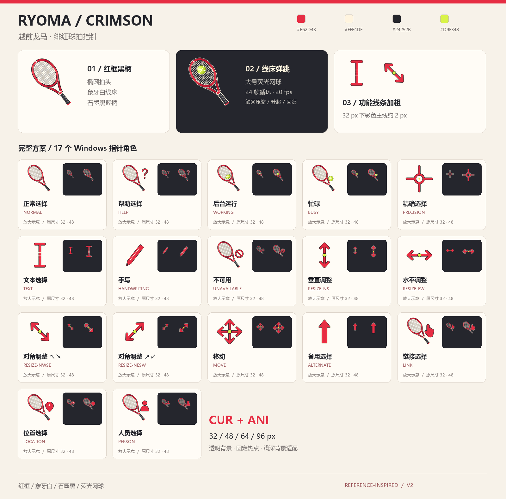
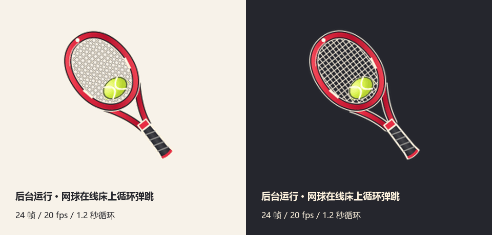
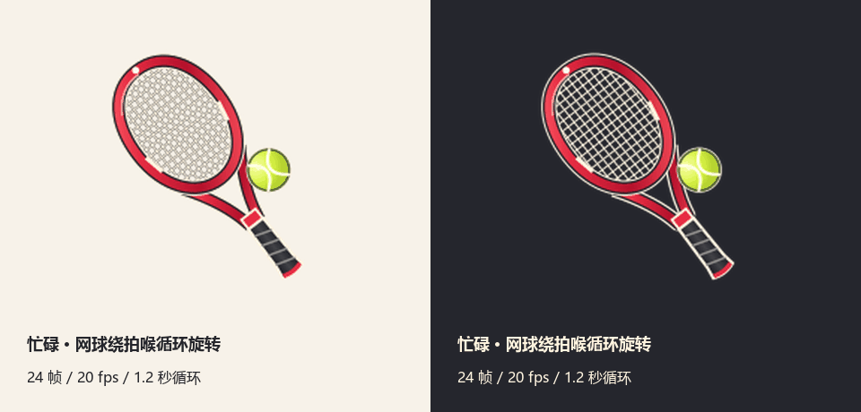

# Ryoma Crimson · 越前龙马绯红球拍指针

以红框球拍为主体设计的 Windows 鼠标指针方案，采用绯红、象牙白、石墨黑与荧光黄绿配色。

**17 种状态 · 15 个 CUR + 2 个 ANI · 32 / 48 / 64 / 96 px · 透明背景**

[下载完整 Windows 指针包](Ryoma-Crimson-Windows.zip?raw=true)



## 动画

后台运行：网球在线床上循环弹跳，触网时轻微压缩，阴影随高度变化。



忙碌：网球绕拍喉旋转，通过前后遮挡表现空间关系。球拍与热点固定。



两种动画均为 24 帧、20 fps、1.2 秒循环。文本、缩放等功能状态使用加粗线条。

## 安装

1. 下载并解压 `Ryoma-Crimson-Windows.zip` 到长期保留的位置。
2. 进入解压后的 `ryoma-crimson` 文件夹，双击 `register.cmd`。
3. 在“鼠标属性 → 指针 → 方案”中选择 **Ryoma Crimson**，单击“应用”。

脚本仅向当前用户注册方案并打开鼠标设置，无需管理员权限。应用后请保留指针文件所在目录。

卸载时先切换至其他方案，再运行 `unregister-scheme.ps1`。

## 安装包内容

ZIP 同时收录可编辑源码、全部 SVG 母版、帧图、验证记录与离线预览。下表中的 `ryoma-crimson/` 目录位于 ZIP 内，解压后即可使用。

| 路径 | 内容 |
| --- | --- |
| `Ryoma-Crimson-Windows.zip` | 可直接使用的完整指针包 |
| `ryoma-crimson/cursors/` | 17 个 Windows 指针文件 |
| `ryoma-crimson/preview/` | 总览、动画、各尺寸图与离线交互预览 |
| `ryoma-crimson/src/` | 矢量绘制、打包与 Windows 验证源码 |
| `ryoma-crimson/manifest.json` | 状态映射与热点坐标 |
| `ryoma-crimson/validation.json` | Windows 原生验证记录 |

离线预览：解压完整指针包后，用浏览器打开 `ryoma-crimson/preview/index.html`。

## 重新构建

先将完整指针包解压到仓库根目录，使 `ryoma-crimson/` 与 `package.json` 位于同一层。
需要 Windows、Python 3.10+、Node.js，以及 Windows 自带的微软雅黑字体。

```powershell
python -m pip install -r requirements.txt
npm install
python ryoma-crimson/src/build.py
```

构建脚本会生成 CUR / ANI、SVG 母版、预览和 ZIP，并调用 Windows API 验证资源。
如需指定其他 Node.js 路径，可设置 `NODE_EXE` 与 `NODE_PATH` 环境变量。

## 验证范围

目前记录包括 17 个角色在四种尺寸下的 68 次 Windows 原生加载、热点检查、透明边界、
内嵌像素一致性，以及两种 ANI 在各尺寸下的 24 帧绘制。验证不会更改系统当前指针或注册表。

Windows 可能根据指针大小及 DPI 设置选择并缩放资源；实际显示大小和热点取整会受系统设置影响。
Word 等应用自行提供的专用指针也可能保持应用原有外观。

本方案按参考图重新绘制，为自制指针作品。
